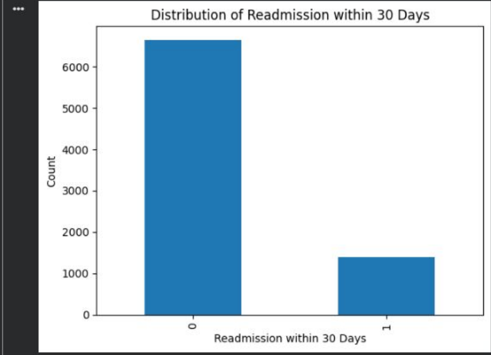
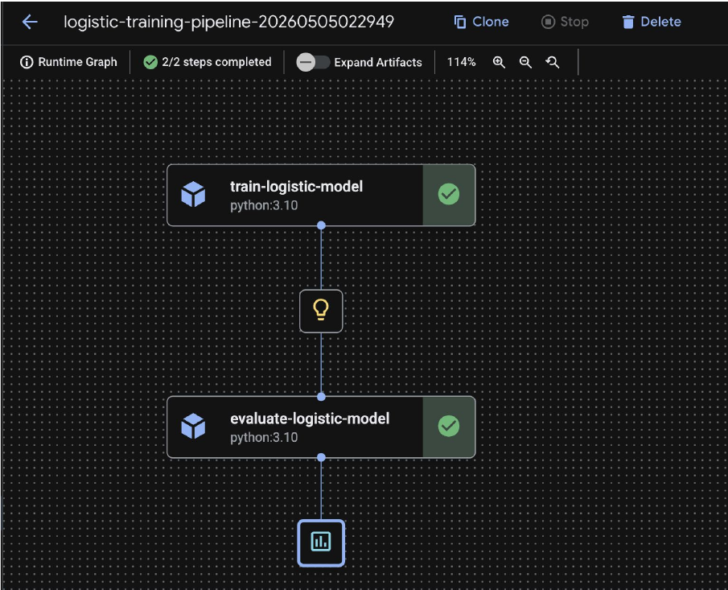

# Healthcare Readmission Prediction on Vertex AI

An end-to-end machine learning workflow on Google Cloud that predicts whether a patient will be readmitted within 30 days of discharge. The project covers exploratory analysis, data preparation, tracked model experiments in Vertex AI Experiments, and training and batch-inference pipelines built with Vertex AI Pipelines (Kubeflow Pipelines).

Final project for ISE 543 at the University of Southern California (Spring 2026), completed by a team of four.

## Workflow

| Step | Folder | What it covers | Contents |
| --- | --- | --- | --- |
| 1 | [`01_eda`](src/01_eda/) | Data quality, target distribution, univariate and bivariate analysis | Code |
| 2 | [`02_data_preparation`](src/02_data_preparation/) | Cleaning, feature engineering, stratified train/validation split | Documentation |
| 3 | [`03_model_experiments`](src/03_model_experiments/) | Five configurations tracked in Vertex AI Experiments | Documentation |
| 4 | [`04_training_pipeline`](src/04_training_pipeline/) | Vertex AI pipeline: train → evaluate | Code |
| 5 | [`05_inference_pipeline`](src/05_inference_pipeline/) | Vertex AI pipeline: train → batch predict | Code |

```
Raw CSV ─► EDA ─► Data preparation ─► Prepared CSVs in Cloud Storage
                                              │
                    ┌─────────────────────────┴─────────────────────────┐
                    ▼                                                   ▼
        Vertex AI Experiments                              Vertex AI Pipelines
        5 configurations compared             Training:  train ─► evaluate (Accuracy, F1, PR-AUC)
                                              Inference: train ─► batch predict ─► predictions.csv
```

## Data

- Training set: 8,038 patients, 19 columns; test set: 1,962 patients without labels.
- Target: `Readmission within 30 Days` (1 = readmitted). Only about 17.3% of patients were readmitted, so F1 and PR-AUC were used alongside accuracy.
- Features cover demographics, hospital ID, health measurements, chronic conditions, lifestyle, prior visits, medications, length of stay, and treatment type.

The dataset was provided for the course and is not included in this repository.



## Results

The baseline Logistic Regression without SMOTE (Con1) had the highest validation F1 among five configurations and was selected for the pipelines.

| Config | Model | SMOTE | Accuracy | F1 | PR-AUC |
| --- | --- | --- | --- | --- | --- |
| **Con1** | Logistic Regression | No | **0.943** | **0.830** | **0.925** |
| Con2 | Logistic Regression | Yes | 0.925 | 0.808 | 0.923 |
| Con5 | Random Forest | Yes | 0.903 | 0.734 | 0.742 |

- SMOTE increased the number of positive predictions but did not improve F1.
- The engineered dataset and stronger hyperparameter settings did not outperform the baseline.
- Logistic Regression outperformed Random Forest on this validation set.

See [03 — Model Experiments](src/03_model_experiments/) for all five configurations, confusion matrices, and the experiment design.

The training pipeline run reported accuracy 0.943, F1 0.832, and PR-AUC 0.927 on the validation set.



## Running the code

```bash
pip install -r requirements.txt

# Step 1: EDA
python src/01_eda/eda.py path/to/healthcare_readmissions_dataset_train.csv

# Steps 4–5: requires a Google Cloud project with Vertex AI enabled
# and the prepared CSV files in a Cloud Storage bucket
export BUCKET_NAME=your-bucket PROJECT_ID=your-project REGION=us-central1
python src/04_training_pipeline/training_pipeline.py                     # compile only
RUN_ON_VERTEX=1 python src/04_training_pipeline/training_pipeline.py     # compile and submit
```

## Notes and limitations

- The original GCP project is no longer active. The code was transcribed from the final presentation and has not been re-run since; bucket names and project IDs were replaced with environment variables.
- Code for steps 2 and 3 was not available, so those steps are documented rather than included as code.
- The classification threshold was left at 0.5; threshold tuning could improve recall for readmitted patients.
- The test set has no labels, so performance is reported on the validation set only.

## Team

Steven Ma, Jackson Li, Ching Lee, and Zhirui Zeng — ISE 543, University of Southern California.

**My contribution (Ching Lee):** designed and ran the [model experiments](src/03_model_experiments/) in Vertex AI Experiments and wrote the Model Experimentation Report.
