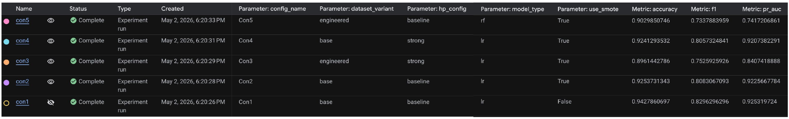

# 03 — Model Experiments

**Owner: Lilian Lee** — designed and ran the model experiments in Vertex AI Experiments and wrote the Model Experimentation Report.

The experiment code is not included in this repository. This page documents the experiment design, results, and conclusions.

## Experiment design

Starting from a baseline Logistic Regression, each step changed one factor at a time:

| Factor tested | Comparison | Change |
| --- | --- | --- |
| Class rebalancing | Con1 → Con2 | Add SMOTE |
| Hyperparameters | Con2 → Con4 | Baseline → strong hyperparameter setting |
| Feature engineering | Con4 → Con3 | Base dataset → engineered top-10 dataset |
| Model choice | Con2 → Con5 | Logistic Regression → Random Forest |

Logistic Regression was used as the baseline for its interpretability and feature importance; Random Forest was added to capture nonlinear relationships. The engineered dataset used the top 10 features ranked by the baseline model's feature importance.

## Configurations and results

Validation set: 1,608 patients (1,329 not readmitted, 279 readmitted). Sorted by F1.

| Config | Model | Dataset | Hyperparameters | SMOTE | TN | FP | FN | TP | Accuracy | F1 | PR-AUC |
| --- | --- | --- | --- | --- | --- | --- | --- | --- | --- | --- | --- |
| **Con1** | Logistic Regression | Base | Baseline | No | 1292 | 37 | 55 | 224 | **0.943** | **0.830** | **0.925** |
| Con2 | Logistic Regression | Base | Baseline | Yes | 1235 | 94 | 26 | 253 | 0.925 | 0.808 | 0.923 |
| Con4 | Logistic Regression | Base | Strong | Yes | 1233 | 96 | 26 | 253 | 0.924 | 0.806 | 0.921 |
| Con3 | Logistic Regression | Engineered | Strong | Yes | 1187 | 142 | 25 | 254 | 0.896 | 0.753 | 0.841 |
| Con5 | Random Forest | Base | Baseline | Yes | 1237 | 92 | 64 | 215 | 0.903 | 0.734 | 0.742 |

Configuration names and parameters follow the runs logged in Vertex AI Experiments. One exception: Con5 was trained on the base dataset, but its run was logged with `dataset_variant = engineered` by mistake.

## Findings

- **SMOTE (Con1 → Con2):** caught more readmitted patients (false negatives fell from 55 to 26) but produced more false positives (37 to 94), so F1 dropped from 0.830 to 0.808.
- **Hyperparameters (Con2 → Con4):** the stronger setting made almost no difference (F1 0.808 → 0.806).
- **Feature engineering (Con4 → Con3):** the engineered top-10 dataset lowered F1 from 0.806 to 0.753 and PR-AUC from 0.921 to 0.841.
- **Model choice (Con2 → Con5):** Random Forest scored lower than Logistic Regression on both F1 (0.734) and PR-AUC (0.742).

## Decision

Con1, a baseline Logistic Regression with standard scaling and no SMOTE, had the highest validation F1 and was used in the [training](../04_training_pipeline/) and [inference](../05_inference_pipeline/) pipelines.
